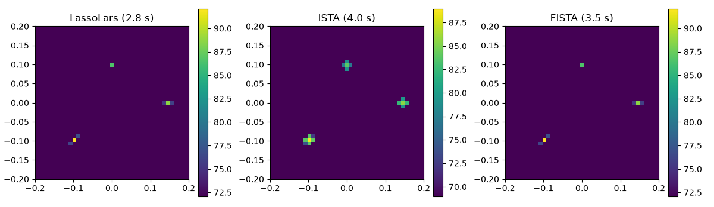

# ucmf

## Installation and checks

Python 3.13 or newer is required.

```bash
uv sync
uv run pytest
uv run ruff check .
uv run python examples/sparse_recovery.py
uv run python examples/benchmark_solvers.py
```

Runtime dependencies are PyTorch and NumPy. The `examples` dependency group
(included in `dev`, installed by `uv sync`) adds Acoular, Matplotlib, PyLops,
and threadpoolctl.
Acoular is taken from the `cmf-problem-assembly` branch via `[tool.uv.sources]`;
the `acoular.solvers` interface used by `ucmf.acoular` is not yet released on PyPI,
so with `pip install -e .` install Acoular separately from that branch:
`pip install "acoular @ git+https://github.com/acoular/acoular.git@cmf-problem-assembly"`.
`import ucmf` never imports Acoular; only `ucmf.acoular` does.
Import Acoular before `ucmf` and NumPy (numba/OpenBLAS threading, see Acoular's
configuration); ruff's isort section order in `pyproject.toml` enforces this, as in Acoular.
TensorFlow, datasets, training code, and the original `fa2026` package are not required.

## Usage

```python
import torch
from ucmf import ISTA, FISTA
from ucmf.optim import SolutionChangeStopper
from ucmf.optim.operator import MatrixMult

A = torch.eye(3)                     # real sensing matrix (m, n)
operator = MatrixMult(A)
y = torch.tensor([[1.0, 0.0, 0.5]])  # measurements (B, m)
stopper = SolutionChangeStopper(tol=1e-6)
solver = FISTA(positive=True, callbacks=[stopper])
with torch.no_grad():
    x_hat = solver(y, operator=operator, lam=0.01, t=100)
# x_hat has shape (B, n); ISTA has the same interface.
```

Existing imports can change from `from fa2026.optim import FISTA, ISTA` to
`from ucmf.optim import FISTA, ISTA`. Top-level imports as above also work.

### Objective and conventions

The solvers minimize

```text
min_x  ||y - A x||² / (2 m) + lam * ||x||₁
```

`positive=True` additionally constrains `x >= 0` (the default).
The negative LS gradient is `A.T @ (y - A @ x) / m`, the threshold is
`gamma * lam`, and the default step size is `gamma = m / (1.05 * ||A||₂²)`,
with the squared norm estimated by 50 power iterations.
Thus `lam` is normalized by the measurement count: an equivalent unnormalized
LASSO uses `lambda_unnormalized = m * lam`.

- `y`: real floating-point tensor, `(m,)` or `(B, m)`.
- `operator`: shared or per-problem `LinearOperator`. Wrap a real `(m, n)` or
  `(B, m, n)` tensor in `MatrixMult`; for CMF, use the dense `CMFDictionary` or
  `CMFPropagation`, which works directly with the propagation matrix `H`.
- `x0`: optional warm-start tensor, `(n,)` for a single sample or `(B, n)`.
- `lam`: required, Python scalar or floating tensor, scalar or per-sample `(B,)` / `(B, 1)`.
- `gamma`: optional, with the same scalar/per-sample forms.
- `t`: non-negative iteration count. Output is always `(B, n)`.

All tensor inputs must already have the same dtype and device as `y`.
Forward validates this and raises `ValueError` for mismatches; it never moves or
casts caller inputs. Convert arrays and prepare tensors explicitly beforehand:

```python
operator = MatrixMult(torch.as_tensor(A, dtype=y.dtype, device=y.device))
# Likewise prepare x0 and tensor-valued lam/gamma, if supplied.
```

There is **no implicit column normalization**. If desired, use
`normalize_sensing_matrix_columns(A)` and explicitly transform coordinates
`z = x * column_norms`, then recover `x = z / column_norms` after solving.
Regularization then acts on `z`, not on the unscaled physical source powers.
For CMF inputs, `A` and `y` must use the same vectorization, row ordering,
diagonal-removal setting, and off-diagonal weights (the source repo uses
`sqrt(2)` weights). The core solvers do not construct or vectorize CSMs; with
[`ucmf.acoular`](#acoular-integration), Acoular's `BeamformerCMF` does this.

### Callbacks and differentiability

`ucmf.optim` also exports:

- `IterationCallback`: override `on_step_begin` / `on_step_end`; set
  `solver.stop = True` to stop. End callbacks receive `gamma`, `theta`, `A`, `W`, `y`;
  `A` and `W` both refer to the same detached operator for classical ISTA/FISTA.
- `SolutionChangeStopper`: relative or absolute iterate-change stopping; every
  sample in the batch must meet the tolerance. Resets on iteration zero.
  The criterion is evaluated only every `check_every` steps (default 100),
  comparing that step's consecutive iterates; checking every step costs about
  +30 % (CPU) to +150 % (CUDA) per iteration for a 4032 × 1681 matrix,
  checking every 100 steps about +1–4 %. Stopping may thus occur up to
  `check_every - 1` steps after the change first fell below `tol`.
- `StepParamCollector`: detached parameter histories, manually reset between
  solves. Scalar parameters produce `(T,)`, per-sample parameters `(T, B, 1)`.
- `IntermediateOutputCollector`: intermediate iterates with their autograd
  graphs, automatically cleared on iteration zero. With `t=0`, no callbacks run.

ISTA and FISTA have no trainable parameters. Gradients can flow through `y`, `x0`,
`lam`, and `gamma`; the operator is treated as fixed and detached. Use `torch.no_grad()`
for inference if no graph is needed.

The classical call interface is
`forward(y, x0=None, t=1, operator=None, lam=None, gamma=None)`.
It does not accept an independent gradient weight `W`, including `W=None`.
Later unfolded models can override `forward` to expose or construct their own
weights and reuse the protected preparation/iteration hooks. Weighted updates
are not classical ISTA/FISTA; their step-size guarantees need separate treatment.

Only normalized least squares is supported. The old `ls_mode` argument and
TLS implementation have been removed; do not pass `ls_mode`, even `'ls'`.

## Acoular integration

`ucmf.acoular` provides ISTA and FISTA as custom solvers for Acoular's
inverse-problem interface, e.g. for `acoular.BeamformerCMF`:

```python
import acoular as ac
from acoular.solvers import L1RegularizedLeastSquaresProblem
from ucmf.acoular import FISTATorchSolver

problem = L1RegularizedLeastSquaresProblem(
    solver=FISTATorchSolver(device='cuda', precision='float32', n_iter=5000),
    alpha=1e-9,
    nonnegative=True,
    dictionary_scaling='unit_l2',
)
bf = ac.BeamformerCMF(freq_data=ps, steer=st, problem=problem)
```

- `TorchSolver(LeastSquaresSolver)` is the shared base class; `ISTATorchSolver`
  and `FISTATorchSolver` select the ucmf solver.
- Traits: `device` (`'cpu'`, `'cuda'`, ...), `precision` (`'float64'` or
  `'float32'`), `n_iter` (iterations per frequency bin), the optional `tol`,
  and `check_every` (default 100). By default (`tol=None`) exactly `n_iter`
  iterations run without callbacks. Setting `tol` enables
  `SolutionChangeStopper(tol=tol, check_every=check_every)`. All traits enter
  the solver digest, so Acoular's caching distinguishes configurations.
- The problem must be an `L1RegularizedLeastSquaresProblem`: positivity comes
  from `problem.nonnegative`, and the regularization is
  `lam = problem.alpha * problem.unit_mult`, matching Acoular's LassoLars
  convention. The ucmf objective equals scikit-learn's Lasso objective, so
  results are directly comparable to `LassoLarsSolver(backend_kwargs={'fit_intercept': False})`.
  Scaling is done by the problem, not the solver.
- An optional `start_value` is used as warm start `x0`. With `tol` set,
  `SolverOutput.info` reports `num_steps` and `converged`; otherwise it is empty.

### Example: three sources

[`examples/sparse_recovery.py`](examples/sparse_recovery.py) simulates the
three white-noise sources of Acoular's introductory example in front of the
64-microphone array and solves the same CMF problem (third-octave band at
8 kHz, `alpha=1e-9`) with LassoLars (CPU) and ISTA and FISTA (2000 iterations
each, CUDA GPU, float64; the example requires a CUDA device). The titles show
the total computation time, including the per-bin CSM and dictionary assembly
shared by all solvers:



FISTA matches the LassoLars map up to a relative difference of about `8e-4`.
ISTA has not yet converged after 2000 iterations and still yields
spatially smeared sources. For this small, very sparse problem, LassoLars
on the CPU is still faster than 2000 first-order iterations on the GPU.

### Benchmark: ucmf vs. PyLops

[`examples/benchmark_solvers.py`](examples/benchmark_solvers.py) compares the
solver time (including step-size computation and data transfer, excluding CSM
and dictionary assembly) of ucmf and PyLops ISTA/FISTA on the same problem:
1000 iterations per frequency bin without early stopping, 5 frequency bins,
dictionary of 4032 × 1681. PyLops has no non-negativity constraint, so all
solvers use `nonnegative=False`; PyLops' objective `||y - A x||² + eps ||x||₁`
matches with `eps = 2 m alpha unit_mult`. PyLops gets ucmf's default step size
(its `alpha = gamma / m`), so both run identical iterations. Thread counts are set with
`torch.set_num_threads` and threadpoolctl (Acoular sets
`OPENBLAS_NUM_THREADS=1` on import). Results on 2× Intel Xeon Silver 4214R (24 cores) and an RTX 3090:

| Algorithm | Implementation | Threads | Time [s] | Speed-up vs. PyLops (1 thread) | Rel. diff. to PyLops |
|---|---|---|---|---|---|
| ISTA | PyLops | 1 | 37.05 | 1.0x | 0 |
| ISTA | ucmf CPU float64 | 1 | 36.28 | 1.0x | 5.0e-16 |
| ISTA | PyLops | 24 | 10.28 | 3.6x | 4.0e-16 |
| ISTA | ucmf CPU float64 | 24 | 5.25 | 7.1x | 4.4e-16 |
| ISTA | ucmf CUDA float64 | - | 0.95 | 38.9x | 4.2e-16 |
| ISTA | ucmf CUDA float32 | - | 0.67 | 55.1x | 2.4e-04 |
| FISTA | PyLops | 1 | 53.82 | 1.0x | 0 |
| FISTA | ucmf CPU float64 | 1 | 36.46 | 1.5x | 1.3e-13 |
| FISTA | PyLops | 24 | 13.08 | 4.1x | 1.4e-13 |
| FISTA | ucmf CPU float64 | 24 | 4.36 | 12.3x | 2.5e-13 |
| FISTA | ucmf CUDA float64 | - | 0.97 | 55.4x | 4.6e-13 |
| FISTA | ucmf CUDA float32 | - | 0.72 | 74.9x | 8.1e-04 |

Both implementations produce the same iterates up to rounding. Single-threaded,
ISTA runs equally fast in both; PyLops FISTA is slower than PyLops ISTA,
ucmf FISTA is not. Multi-threaded, ucmf is 2.0–3.0× faster than PyLops, and on
the GPU another 4.5–8× faster than its own multi-threaded CPU run.

### Benchmark: dense and matrix-free CMF operators

[`examples/benchmark_operators.py`](examples/benchmark_operators.py) measures all 280 supported configurations in both modes.
Select a CUDA device with `CUDA_VISIBLE_DEVICES`, then run `uv run python examples/benchmark_operators.py --steps 15 --repeats 7`.

RTX 3090 (GPUs 001 and 002), PyTorch 2.12.0+cu130, float32 without TF32, `r_diag=True`, 15 iterations. ISTA/FISTA run
without gradients; Ada timings include parameter gradients but no optimizer step. Solver-side weight preparation is timed;
operator construction and step-size estimation are excluded. Shared cases reuse one operator; distinct cases alternate two
independent batches, each with one dictionary per sample. Batch 1 needs no distinct case; batch 512 is measured at 16 microphones
and a 16 × 16 grid only. `MatrixMult` and `CMFDictionary` use the same dense products; only the latter retains CMF metadata.

Times are medians of seven synchronized runs after warm-up. Compiled runs use `torch.compile(mode='reduce-overhead', fullgraph=True)`.
The first compiled call includes compilation or cache loading. Peak memory is PyTorch-reserved GPU memory during warm timing,
including both input batches and any captured graphs. Solutions and, where applicable, gradients are checked against eager
`CMFPropagation` before timing. Unsupported combinations are omitted; no measured configuration ran out of memory.

<details>
<summary>16 microphones, 16 × 16 grid (256 points)</summary>

| Batch | Dictionaries | Model | Operator | Weight | Eager ms | Compiled ms | First compiled s | Eager peak MiB | Compiled peak MiB |
|---:|---|---|---|---|---:|---:|---:|---:|---:|
| 1 | shared | ISTA | MatrixMult | — | 1.672 | 0.238 | 3.680 | 22 | 24 |
| 1 | shared | ISTA | CMFDictionary | — | 1.813 | 0.233 | 1.131 | 22 | 24 |
| 1 | shared | ISTA | CMFPropagation | — | 10.835 | 0.646 | 7.060 | 22 | 24 |
| 1 | shared | FISTA | MatrixMult | — | 2.175 | 0.238 | 2.755 | 22 | 24 |
| 1 | shared | FISTA | CMFDictionary | — | 2.160 | 0.246 | 1.908 | 22 | 24 |
| 1 | shared | FISTA | CMFPropagation | — | 11.431 | 0.641 | 9.759 | 22 | 24 |
| 1 | shared | AdaLFISTASW | MatrixMult | factored | 16.257 | 1.120 | 10.038 | 22 | 24 |
| 1 | shared | AdaLFISTASW | MatrixMult | precomputed | 18.523 | 1.247 | 8.236 | 22 | 24 |
| 1 | shared | AdaLFISTASW | CMFDictionary | factored | 21.544 | 1.657 | 6.205 | 22 | 24 |
| 1 | shared | AdaLFISTASW | CMFDictionary | precomputed | 18.378 | 1.629 | 6.313 | 22 | 24 |
| 1 | shared | AdaLFISTASW | CMFPropagation | factored | 50.673 | 1.705 | 21.119 | 22 | 24 |
| 1 | shared | AdaLFISTA | MatrixMult | factored | 18.977 | 1.527 | 12.010 | 22 | 24 |
| 1 | shared | AdaLFISTA | MatrixMult | precomputed | 20.102 | 1.719 | 10.985 | 24 | 24 |
| 1 | shared | AdaLFISTA | CMFDictionary | factored | 26.503 | 1.726 | 6.844 | 22 | 24 |
| 1 | shared | AdaLFISTA | CMFDictionary | precomputed | 23.177 | 1.253 | 6.593 | 24 | 24 |
| 1 | shared | AdaLFISTA | CMFPropagation | factored | 53.704 | 2.221 | 25.403 | 22 | 24 |
| 1 | shared | AdaLFISTASWR | CMFDictionary | factored | 50.515 | 2.234 | 19.392 | 22 | 24 |
| 1 | shared | AdaLFISTASWR | CMFPropagation | factored | 69.707 | 2.950 | 34.352 | 22 | 24 |
| 1 | shared | AdaLFISTAR | CMFDictionary | factored | 72.535 | 3.437 | 36.309 | 22 | 24 |
| 1 | shared | AdaLFISTAR | CMFPropagation | factored | 90.915 | 3.813 | 55.515 | 22 | 24 |
| 32 | shared | ISTA | MatrixMult | — | 2.368 | 0.406 | 1.608 | 22 | 24 |
| 32 | shared | ISTA | CMFDictionary | — | 1.835 | 0.410 | 1.252 | 22 | 24 |
| 32 | shared | ISTA | CMFPropagation | — | 11.362 | 0.683 | 7.714 | 24 | 26 |
| 32 | shared | FISTA | MatrixMult | — | 2.143 | 0.410 | 2.773 | 22 | 24 |
| 32 | shared | FISTA | CMFDictionary | — | 2.430 | 0.408 | 1.661 | 22 | 24 |
| 32 | shared | FISTA | CMFPropagation | — | 11.852 | 0.707 | 10.004 | 24 | 26 |
| 32 | shared | AdaLFISTASW | MatrixMult | factored | 19.749 | 1.991 | 8.756 | 24 | 26 |
| 32 | shared | AdaLFISTASW | MatrixMult | precomputed | 18.891 | 1.866 | 6.740 | 24 | 26 |
| 32 | shared | AdaLFISTASW | CMFDictionary | factored | 20.528 | 1.983 | 6.403 | 24 | 26 |
| 32 | shared | AdaLFISTASW | CMFDictionary | precomputed | 19.134 | 1.768 | 6.332 | 24 | 26 |
| 32 | shared | AdaLFISTASW | CMFPropagation | factored | 51.888 | 2.483 | 21.731 | 26 | 28 |
| 32 | shared | AdaLFISTA | MatrixMult | factored | 22.663 | 2.164 | 9.666 | 24 | 26 |
| 32 | shared | AdaLFISTA | MatrixMult | precomputed | 18.772 | 2.049 | 8.706 | 26 | 26 |
| 32 | shared | AdaLFISTA | CMFDictionary | factored | 21.886 | 2.266 | 7.566 | 24 | 26 |
| 32 | shared | AdaLFISTA | CMFDictionary | precomputed | 24.239 | 2.413 | 7.755 | 26 | 26 |
| 32 | shared | AdaLFISTA | CMFPropagation | factored | 64.376 | 2.484 | 23.832 | 26 | 30 |
| 32 | shared | AdaLFISTASWR | CMFDictionary | factored | 50.423 | 2.647 | 19.752 | 26 | 26 |
| 32 | shared | AdaLFISTASWR | CMFPropagation | factored | 65.848 | 3.181 | 35.794 | 28 | 30 |
| 32 | shared | AdaLFISTAR | CMFDictionary | factored | 74.811 | 3.771 | 38.501 | 28 | 30 |
| 32 | shared | AdaLFISTAR | CMFPropagation | factored | 90.832 | 4.404 | 55.447 | 32 | 32 |
| 32 | distinct | ISTA | MatrixMult | — | 2.001 | 0.427 | 1.682 | 42 | 64 |
| 32 | distinct | ISTA | CMFDictionary | — | 1.883 | 0.424 | 1.267 | 64 | 86 |
| 32 | distinct | ISTA | CMFPropagation | — | 10.883 | 0.938 | 7.740 | 48 | 44 |
| 32 | distinct | FISTA | MatrixMult | — | 2.412 | 0.426 | 2.859 | 42 | 64 |
| 32 | distinct | FISTA | CMFDictionary | — | 2.315 | 0.431 | 1.694 | 66 | 88 |
| 32 | distinct | FISTA | CMFPropagation | — | 11.455 | 0.964 | 10.554 | 48 | 44 |
| 32 | distinct | AdaLFISTASW | MatrixMult | factored | 24.884 | 2.103 | 9.935 | 64 | 66 |
| 32 | distinct | AdaLFISTASW | MatrixMult | precomputed | 20.931 | 2.018 | 11.740 | 84 | 84 |
| 32 | distinct | AdaLFISTASW | CMFDictionary | factored | 23.628 | 2.188 | 7.632 | 66 | 68 |
| 32 | distinct | AdaLFISTASW | CMFDictionary | precomputed | 22.752 | 2.041 | 7.500 | 84 | 86 |
| 32 | distinct | AdaLFISTASW | CMFPropagation | factored | 53.780 | 2.380 | 17.184 | 30 | 32 |
| 32 | distinct | AdaLFISTA | MatrixMult | factored | 23.803 | 2.227 | 9.808 | 66 | 66 |
| 32 | distinct | AdaLFISTA | MatrixMult | precomputed | 24.594 | 2.380 | 13.622 | 84 | 88 |
| 32 | distinct | AdaLFISTA | CMFDictionary | factored | 26.486 | 2.237 | 8.118 | 66 | 68 |
| 32 | distinct | AdaLFISTA | CMFDictionary | precomputed | 21.467 | 1.514 | 7.162 | 88 | 90 |
| 32 | distinct | AdaLFISTA | CMFPropagation | factored | 53.604 | 2.818 | 19.173 | 52 | 32 |
| 32 | distinct | AdaLFISTASWR | CMFDictionary | factored | 54.716 | 2.712 | 22.601 | 68 | 70 |
| 32 | distinct | AdaLFISTASWR | CMFPropagation | factored | 78.484 | 3.438 | 31.331 | 32 | 34 |
| 32 | distinct | AdaLFISTAR | CMFDictionary | factored | 74.016 | 3.972 | 37.627 | 70 | 72 |
| 32 | distinct | AdaLFISTAR | CMFPropagation | factored | 111.250 | 4.679 | 51.389 | 34 | 34 |
| 512 | shared | ISTA | MatrixMult | — | 2.349 | 0.488 | 1.422 | 24 | 28 |
| 512 | shared | ISTA | CMFDictionary | — | 1.861 | 0.498 | 1.192 | 26 | 30 |
| 512 | shared | ISTA | CMFPropagation | — | 11.766 | 2.996 | 7.976 | 60 | 64 |
| 512 | shared | FISTA | MatrixMult | — | 2.330 | 0.481 | 2.770 | 26 | 30 |
| 512 | shared | FISTA | CMFDictionary | — | 2.185 | 0.486 | 2.106 | 26 | 28 |
| 512 | shared | FISTA | CMFPropagation | — | 11.232 | 3.016 | 9.342 | 60 | 64 |
| 512 | shared | AdaLFISTASW | MatrixMult | factored | 26.392 | 2.258 | 10.949 | 48 | 52 |
| 512 | shared | AdaLFISTASW | MatrixMult | precomputed | 21.897 | 2.111 | 8.814 | 50 | 50 |
| 512 | shared | AdaLFISTASW | CMFDictionary | factored | 24.216 | 2.329 | 8.022 | 48 | 50 |
| 512 | shared | AdaLFISTASW | CMFDictionary | precomputed | 23.642 | 2.089 | 8.002 | 48 | 48 |
| 512 | shared | AdaLFISTASW | CMFPropagation | factored | 59.415 | 7.235 | 23.544 | 96 | 102 |
| 512 | shared | AdaLFISTA | MatrixMult | factored | 26.157 | 2.688 | 12.245 | 58 | 58 |
| 512 | shared | AdaLFISTA | MatrixMult | precomputed | 20.616 | 2.808 | 10.203 | 56 | 58 |
| 512 | shared | AdaLFISTA | CMFDictionary | factored | 25.813 | 2.659 | 9.321 | 56 | 58 |
| 512 | shared | AdaLFISTA | CMFDictionary | precomputed | 22.633 | 2.523 | 8.896 | 56 | 58 |
| 512 | shared | AdaLFISTA | CMFPropagation | factored | 57.284 | 7.965 | 26.593 | 106 | 110 |
| 512 | shared | AdaLFISTASWR | CMFDictionary | factored | 55.788 | 3.210 | 23.418 | 86 | 76 |
| 512 | shared | AdaLFISTASWR | CMFPropagation | factored | 77.645 | 8.315 | 37.964 | 132 | 122 |
| 512 | shared | AdaLFISTAR | CMFDictionary | factored | 82.288 | 4.841 | 41.353 | 134 | 108 |
| 512 | shared | AdaLFISTAR | CMFPropagation | factored | 107.110 | 10.343 | 57.712 | 182 | 154 |
| 512 | distinct | ISTA | MatrixMult | — | 4.780 | 4.958 | 1.635 | 264 | 388 |
| 512 | distinct | ISTA | CMFDictionary | — | 4.771 | 4.960 | 1.337 | 418 | 540 |
| 512 | distinct | ISTA | CMFPropagation | — | 11.571 | 4.753 | 8.322 | 364 | 348 |
| 512 | distinct | FISTA | MatrixMult | — | 4.908 | 4.987 | 2.973 | 282 | 404 |
| 512 | distinct | FISTA | CMFDictionary | — | 4.930 | 5.009 | 1.724 | 434 | 556 |
| 512 | distinct | FISTA | CMFPropagation | — | 11.405 | 4.782 | 11.069 | 380 | 352 |
| 512 | distinct | AdaLFISTASW | MatrixMult | factored | 28.207 | 10.132 | 11.078 | 288 | 410 |
| 512 | distinct | AdaLFISTASW | MatrixMult | precomputed | 24.064 | 11.568 | 13.404 | 770 | 644 |
| 512 | distinct | AdaLFISTASW | CMFDictionary | factored | 23.369 | 10.155 | 9.129 | 442 | 442 |
| 512 | distinct | AdaLFISTASW | CMFDictionary | precomputed | 23.714 | 11.586 | 8.973 | 816 | 676 |
| 512 | distinct | AdaLFISTASW | CMFPropagation | factored | 54.509 | 9.653 | 18.334 | 280 | 164 |
| 512 | distinct | AdaLFISTA | MatrixMult | factored | 27.617 | 10.976 | 11.920 | 312 | 420 |
| 512 | distinct | AdaLFISTA | MatrixMult | precomputed | 31.091 | 13.314 | 16.130 | 656 | 658 |
| 512 | distinct | AdaLFISTA | CMFDictionary | factored | 27.227 | 10.940 | 9.344 | 328 | 450 |
| 512 | distinct | AdaLFISTA | CMFDictionary | precomputed | 30.735 | 13.558 | 8.446 | 688 | 690 |
| 512 | distinct | AdaLFISTA | CMFPropagation | factored | 54.812 | 10.543 | 19.580 | 290 | 174 |
| 512 | distinct | AdaLFISTASWR | CMFDictionary | factored | 53.295 | 11.535 | 25.371 | 360 | 466 |
| 512 | distinct | AdaLFISTASWR | CMFPropagation | factored | 71.753 | 10.835 | 32.754 | 182 | 186 |
| 512 | distinct | AdaLFISTAR | CMFDictionary | factored | 72.400 | 13.689 | 39.375 | 408 | 526 |
| 512 | distinct | AdaLFISTAR | CMFPropagation | factored | 93.451 | 12.860 | 52.870 | 230 | 218 |

</details>

<details>
<summary>16 microphones, 64 × 64 grid (4,096 points)</summary>

| Batch | Dictionaries | Model | Operator | Weight | Eager ms | Compiled ms | First compiled s | Eager peak MiB | Compiled peak MiB |
|---:|---|---|---|---|---:|---:|---:|---:|---:|
| 1 | shared | ISTA | MatrixMult | — | 1.863 | 0.326 | 1.974 | 40 | 44 |
| 1 | shared | ISTA | CMFDictionary | — | 1.853 | 0.331 | 1.089 | 42 | 64 |
| 1 | shared | ISTA | CMFPropagation | — | 10.908 | 0.728 | 7.055 | 44 | 74 |
| 1 | shared | FISTA | MatrixMult | — | 2.306 | 0.330 | 3.383 | 44 | 44 |
| 1 | shared | FISTA | CMFDictionary | — | 2.385 | 0.339 | 1.557 | 42 | 64 |
| 1 | shared | FISTA | CMFPropagation | — | 11.419 | 0.711 | 10.309 | 44 | 32 |
| 1 | shared | AdaLFISTASW | MatrixMult | factored | 23.625 | 1.650 | 7.771 | 42 | 44 |
| 1 | shared | AdaLFISTASW | MatrixMult | precomputed | 20.436 | 1.260 | 8.006 | 42 | 64 |
| 1 | shared | AdaLFISTASW | CMFDictionary | factored | 19.508 | 1.713 | 5.945 | 42 | 44 |
| 1 | shared | AdaLFISTASW | CMFDictionary | precomputed | 20.498 | 1.780 | 6.501 | 44 | 44 |
| 1 | shared | AdaLFISTASW | CMFPropagation | factored | 53.552 | 2.447 | 21.207 | 24 | 26 |
| 1 | shared | AdaLFISTA | MatrixMult | factored | 21.738 | 1.979 | 8.659 | 42 | 44 |
| 1 | shared | AdaLFISTA | MatrixMult | precomputed | 23.861 | 1.796 | 8.466 | 42 | 64 |
| 1 | shared | AdaLFISTA | CMFDictionary | factored | 25.999 | 1.940 | 6.929 | 44 | 44 |
| 1 | shared | AdaLFISTA | CMFDictionary | precomputed | 21.096 | 1.736 | 6.642 | 44 | 46 |
| 1 | shared | AdaLFISTA | CMFPropagation | factored | 54.719 | 2.242 | 22.021 | 26 | 26 |
| 1 | shared | AdaLFISTASWR | CMFDictionary | factored | 53.744 | 2.436 | 20.191 | 42 | 44 |
| 1 | shared | AdaLFISTASWR | CMFPropagation | factored | 71.465 | 2.805 | 36.206 | 24 | 26 |
| 1 | shared | AdaLFISTAR | CMFDictionary | factored | 73.109 | 3.842 | 36.409 | 42 | 44 |
| 1 | shared | AdaLFISTAR | CMFPropagation | factored | 93.624 | 3.950 | 54.348 | 24 | 26 |
| 32 | shared | ISTA | MatrixMult | — | 2.477 | 0.547 | 1.365 | 40 | 40 |
| 32 | shared | ISTA | CMFDictionary | — | 1.920 | 0.551 | 1.161 | 36 | 56 |
| 32 | shared | ISTA | CMFPropagation | — | 11.713 | 2.804 | 8.254 | 68 | 66 |
| 32 | shared | FISTA | MatrixMult | — | 2.288 | 0.559 | 2.771 | 40 | 44 |
| 32 | shared | FISTA | CMFDictionary | — | 2.280 | 0.563 | 1.565 | 38 | 60 |
| 32 | shared | FISTA | CMFPropagation | — | 11.281 | 2.827 | 10.422 | 70 | 66 |
| 32 | shared | AdaLFISTASW | MatrixMult | factored | 19.698 | 2.212 | 8.927 | 56 | 58 |
| 32 | shared | AdaLFISTASW | MatrixMult | precomputed | 23.380 | 2.106 | 7.362 | 56 | 60 |
| 32 | shared | AdaLFISTASW | CMFDictionary | factored | 24.878 | 2.438 | 8.249 | 52 | 58 |
| 32 | shared | AdaLFISTASW | CMFDictionary | precomputed | 21.605 | 2.317 | 8.152 | 74 | 60 |
| 32 | shared | AdaLFISTASW | CMFPropagation | factored | 52.888 | 6.638 | 23.295 | 74 | 74 |
| 32 | shared | AdaLFISTA | MatrixMult | factored | 24.207 | 2.457 | 9.812 | 58 | 60 |
| 32 | shared | AdaLFISTA | MatrixMult | precomputed | 22.638 | 2.431 | 9.072 | 80 | 70 |
| 32 | shared | AdaLFISTA | CMFDictionary | factored | 28.276 | 2.472 | 9.280 | 54 | 60 |
| 32 | shared | AdaLFISTA | CMFDictionary | precomputed | 22.640 | 2.275 | 9.095 | 64 | 70 |
| 32 | shared | AdaLFISTA | CMFPropagation | factored | 54.984 | 7.189 | 26.152 | 74 | 92 |
| 32 | shared | AdaLFISTASWR | CMFDictionary | factored | 51.899 | 3.103 | 22.680 | 58 | 58 |
| 32 | shared | AdaLFISTASWR | CMFPropagation | factored | 71.240 | 7.205 | 37.296 | 76 | 74 |
| 32 | shared | AdaLFISTAR | CMFDictionary | factored | 74.635 | 3.979 | 40.226 | 62 | 62 |
| 32 | shared | AdaLFISTAR | CMFPropagation | factored | 93.333 | 9.113 | 57.151 | 78 | 94 |
| 32 | distinct | ISTA | MatrixMult | — | 4.731 | 4.932 | 1.408 | 264 | 384 |
| 32 | distinct | ISTA | CMFDictionary | — | 4.744 | 4.939 | 1.285 | 416 | 536 |
| 32 | distinct | ISTA | CMFPropagation | — | 14.721 | 8.597 | 8.350 | 360 | 344 |
| 32 | distinct | FISTA | MatrixMult | — | 4.835 | 4.961 | 3.001 | 280 | 402 |
| 32 | distinct | FISTA | CMFDictionary | — | 4.869 | 4.966 | 1.796 | 432 | 554 |
| 32 | distinct | FISTA | CMFPropagation | — | 14.915 | 8.611 | 10.778 | 376 | 346 |
| 32 | distinct | AdaLFISTASW | MatrixMult | factored | 24.414 | 9.892 | 9.925 | 280 | 402 |
| 32 | distinct | AdaLFISTASW | MatrixMult | precomputed | 23.931 | 11.681 | 10.363 | 760 | 522 |
| 32 | distinct | AdaLFISTASW | CMFDictionary | factored | 23.980 | 9.989 | 8.526 | 312 | 434 |
| 32 | distinct | AdaLFISTASW | CMFDictionary | precomputed | 28.035 | 11.830 | 9.425 | 808 | 554 |
| 32 | distinct | AdaLFISTASW | CMFPropagation | factored | 58.620 | 15.608 | 19.327 | 258 | 152 |
| 32 | distinct | AdaLFISTA | MatrixMult | factored | 25.251 | 10.500 | 9.921 | 298 | 404 |
| 32 | distinct | AdaLFISTA | MatrixMult | precomputed | 31.134 | 12.464 | 9.728 | 648 | 530 |
| 32 | distinct | AdaLFISTA | CMFDictionary | factored | 26.665 | 10.477 | 9.764 | 312 | 436 |
| 32 | distinct | AdaLFISTA | CMFDictionary | precomputed | 33.811 | 12.638 | 7.749 | 680 | 562 |
| 32 | distinct | AdaLFISTA | CMFPropagation | factored | 56.776 | 16.722 | 21.223 | 258 | 154 |
| 32 | distinct | AdaLFISTASWR | CMFDictionary | factored | 52.787 | 10.870 | 24.278 | 314 | 434 |
| 32 | distinct | AdaLFISTASWR | CMFPropagation | factored | 75.793 | 16.318 | 31.996 | 124 | 154 |
| 32 | distinct | AdaLFISTAR | CMFDictionary | factored | 74.928 | 12.493 | 39.664 | 318 | 436 |
| 32 | distinct | AdaLFISTAR | CMFPropagation | factored | 95.553 | 19.865 | 53.081 | 126 | 156 |

</details>

<details>
<summary>64 microphones, 16 × 16 grid (256 points)</summary>

| Batch | Dictionaries | Model | Operator | Weight | Eager ms | Compiled ms | First compiled s | Eager peak MiB | Compiled peak MiB |
|---:|---|---|---|---|---:|---:|---:|---:|---:|
| 1 | shared | ISTA | MatrixMult | — | 1.683 | 0.309 | 1.307 | 22 | 44 |
| 1 | shared | ISTA | CMFDictionary | — | 1.718 | 0.341 | 1.094 | 42 | 64 |
| 1 | shared | ISTA | CMFPropagation | — | 10.597 | 0.920 | 6.918 | 42 | 66 |
| 1 | shared | FISTA | MatrixMult | — | 2.174 | 0.347 | 2.818 | 42 | 64 |
| 1 | shared | FISTA | CMFDictionary | — | 2.331 | 0.344 | 2.593 | 42 | 44 |
| 1 | shared | FISTA | CMFPropagation | — | 11.123 | 0.921 | 7.055 | 22 | 46 |
| 1 | shared | AdaLFISTASW | MatrixMult | factored | 20.912 | 3.268 | 7.016 | 278 | 216 |
| 1 | shared | AdaLFISTASW | MatrixMult | precomputed | 19.912 | 2.094 | 9.917 | 258 | 236 |
| 1 | shared | AdaLFISTASW | CMFDictionary | factored | 21.571 | 3.266 | 6.722 | 322 | 216 |
| 1 | shared | AdaLFISTASW | CMFDictionary | precomputed | 20.233 | 2.110 | 5.484 | 214 | 216 |
| 1 | shared | AdaLFISTASW | CMFPropagation | factored | 47.991 | 4.406 | 18.549 | 322 | 152 |
| 1 | shared | AdaLFISTA | MatrixMult | factored | 23.485 | 6.163 | 9.638 | 342 | 300 |
| 1 | shared | AdaLFISTA | MatrixMult | precomputed | 22.456 | 2.254 | 11.686 | 470 | 320 |
| 1 | shared | AdaLFISTA | CMFDictionary | factored | 23.932 | 6.313 | 6.298 | 342 | 344 |
| 1 | shared | AdaLFISTA | CMFDictionary | precomputed | 21.096 | 2.240 | 6.714 | 450 | 344 |
| 1 | shared | AdaLFISTA | CMFPropagation | factored | 50.649 | 7.097 | 20.176 | 452 | 280 |
| 1 | shared | AdaLFISTASWR | CMFDictionary | factored | 51.583 | 2.027 | 19.759 | 44 | 44 |
| 1 | shared | AdaLFISTASWR | CMFPropagation | factored | 69.548 | 3.167 | 32.207 | 44 | 24 |
| 1 | shared | AdaLFISTAR | CMFDictionary | factored | 72.026 | 3.380 | 37.229 | 44 | 46 |
| 1 | shared | AdaLFISTAR | CMFPropagation | factored | 87.981 | 4.729 | 49.703 | 26 | 26 |
| 32 | shared | ISTA | MatrixMult | — | 1.824 | 0.481 | 1.325 | 24 | 46 |
| 32 | shared | ISTA | CMFDictionary | — | 1.970 | 0.540 | 1.141 | 44 | 66 |
| 32 | shared | ISTA | CMFPropagation | — | 10.994 | 1.573 | 8.334 | 48 | 50 |
| 32 | shared | FISTA | MatrixMult | — | 2.336 | 0.546 | 2.851 | 24 | 46 |
| 32 | shared | FISTA | CMFDictionary | — | 2.483 | 0.552 | 1.686 | 46 | 68 |
| 32 | shared | FISTA | CMFPropagation | — | 11.298 | 1.579 | 10.023 | 48 | 50 |
| 32 | shared | AdaLFISTASW | MatrixMult | factored | 21.572 | 8.488 | 7.580 | 288 | 246 |
| 32 | shared | AdaLFISTASW | MatrixMult | precomputed | 20.686 | 2.807 | 8.126 | 288 | 180 |
| 32 | shared | AdaLFISTASW | CMFDictionary | factored | 22.337 | 8.497 | 6.044 | 352 | 310 |
| 32 | shared | AdaLFISTASW | CMFDictionary | precomputed | 20.880 | 2.812 | 7.020 | 328 | 182 |
| 32 | shared | AdaLFISTASW | CMFPropagation | factored | 46.675 | 10.736 | 20.400 | 368 | 252 |
| 32 | shared | AdaLFISTA | MatrixMult | factored | 24.050 | 16.689 | 9.424 | 360 | 318 |
| 32 | shared | AdaLFISTA | MatrixMult | precomputed | 22.537 | 3.226 | 9.229 | 480 | 318 |
| 32 | shared | AdaLFISTA | CMFDictionary | factored | 23.924 | 16.410 | 8.010 | 488 | 318 |
| 32 | shared | AdaLFISTA | CMFDictionary | precomputed | 22.707 | 3.176 | 6.726 | 352 | 318 |
| 32 | shared | AdaLFISTA | CMFPropagation | factored | 50.139 | 18.681 | 23.451 | 504 | 324 |
| 32 | shared | AdaLFISTASWR | CMFDictionary | factored | 61.455 | 3.248 | 21.705 | 158 | 82 |
| 32 | shared | AdaLFISTASWR | CMFPropagation | factored | 72.207 | 5.210 | 36.017 | 106 | 82 |
| 32 | shared | AdaLFISTAR | CMFDictionary | factored | 72.556 | 5.241 | 37.558 | 140 | 142 |
| 32 | shared | AdaLFISTAR | CMFPropagation | factored | 92.628 | 7.457 | 56.388 | 156 | 158 |
| 32 | distinct | ISTA | MatrixMult | — | 4.773 | 5.022 | 1.467 | 404 | 532 |
| 32 | distinct | ISTA | CMFDictionary | — | 4.790 | 5.033 | 2.162 | 552 | 446 |
| 32 | distinct | ISTA | CMFPropagation | — | 12.174 | 1.960 | 7.458 | 172 | 254 |
| 32 | distinct | FISTA | MatrixMult | — | 4.922 | 5.038 | 2.825 | 424 | 552 |
| 32 | distinct | FISTA | CMFDictionary | — | 4.888 | 5.039 | 1.699 | 550 | 678 |
| 32 | distinct | FISTA | CMFPropagation | — | 11.496 | 1.972 | 10.228 | 446 | 150 |
| 32 | distinct | AdaLFISTASW | MatrixMult | factored | 22.929 | 16.927 | 8.957 | 496 | 612 |
| 32 | distinct | AdaLFISTASW | MatrixMult | precomputed | 47.023 | 38.131 | 12.462 | 2922 | 2588 |
| 32 | distinct | AdaLFISTASW | CMFDictionary | factored | 22.776 | 16.936 | 6.909 | 496 | 652 |
| 32 | distinct | AdaLFISTASW | CMFDictionary | precomputed | 47.030 | 37.898 | 7.961 | 2922 | 4466 |
| 32 | distinct | AdaLFISTASW | CMFPropagation | factored | 47.412 | 11.188 | 16.836 | 472 | 282 |
| 32 | distinct | AdaLFISTA | MatrixMult | factored | 27.842 | 25.054 | 10.154 | 568 | 688 |
| 32 | distinct | AdaLFISTA | MatrixMult | precomputed | 57.144 | 40.202 | 13.749 | 2796 | 4520 |
| 32 | distinct | AdaLFISTA | CMFDictionary | factored | 28.119 | 25.187 | 8.654 | 822 | 728 |
| 32 | distinct | AdaLFISTA | CMFDictionary | precomputed | 57.225 | 39.970 | 7.621 | 3050 | 4540 |
| 32 | distinct | AdaLFISTA | CMFPropagation | factored | 51.922 | 19.307 | 19.920 | 606 | 354 |
| 32 | distinct | AdaLFISTASWR | CMFDictionary | factored | 54.829 | 11.506 | 23.159 | 410 | 458 |
| 32 | distinct | AdaLFISTASWR | CMFPropagation | factored | 79.871 | 5.742 | 32.380 | 126 | 122 |
| 32 | distinct | AdaLFISTAR | CMFDictionary | factored | 76.060 | 14.065 | 38.322 | 392 | 540 |
| 32 | distinct | AdaLFISTAR | CMFPropagation | factored | 108.977 | 8.025 | 53.024 | 176 | 198 |

</details>

<details>
<summary>64 microphones, 64 × 64 grid (4,096 points)</summary>

| Batch | Dictionaries | Model | Operator | Weight | Eager ms | Compiled ms | First compiled s | Eager peak MiB | Compiled peak MiB |
|---:|---|---|---|---|---:|---:|---:|---:|---:|
| 1 | shared | ISTA | MatrixMult | — | 2.668 | 2.696 | 1.255 | 86 | 152 |
| 1 | shared | ISTA | CMFDictionary | — | 2.677 | 2.717 | 1.100 | 150 | 236 |
| 1 | shared | ISTA | CMFPropagation | — | 10.813 | 1.070 | 6.749 | 150 | 212 |
| 1 | shared | FISTA | MatrixMult | — | 2.816 | 2.722 | 2.734 | 214 | 300 |
| 1 | shared | FISTA | CMFDictionary | — | 2.837 | 2.742 | 2.544 | 278 | 172 |
| 1 | shared | FISTA | CMFPropagation | — | 11.824 | 1.070 | 7.288 | 86 | 148 |
| 1 | shared | AdaLFISTASW | MatrixMult | factored | 16.837 | 7.773 | 10.202 | 342 | 280 |
| 1 | shared | AdaLFISTASW | MatrixMult | precomputed | 27.566 | 18.110 | 6.639 | 406 | 344 |
| 1 | shared | AdaLFISTASW | CMFDictionary | factored | 21.060 | 7.846 | 6.082 | 470 | 236 |
| 1 | shared | AdaLFISTASW | CMFDictionary | precomputed | 27.547 | 17.940 | 6.119 | 534 | 364 |
| 1 | shared | AdaLFISTASW | CMFPropagation | factored | 46.495 | 4.624 | 17.900 | 278 | 256 |
| 1 | shared | AdaLFISTA | MatrixMult | factored | 24.958 | 10.763 | 9.587 | 426 | 344 |
| 1 | shared | AdaLFISTA | MatrixMult | precomputed | 29.428 | 18.603 | 7.541 | 470 | 472 |
| 1 | shared | AdaLFISTA | CMFDictionary | factored | 21.305 | 10.797 | 7.067 | 598 | 364 |
| 1 | shared | AdaLFISTA | CMFDictionary | precomputed | 29.489 | 18.724 | 6.672 | 662 | 492 |
| 1 | shared | AdaLFISTA | CMFPropagation | factored | 52.948 | 7.825 | 19.493 | 342 | 320 |
| 1 | shared | AdaLFISTASWR | CMFDictionary | factored | 50.418 | 6.595 | 19.890 | 108 | 172 |
| 1 | shared | AdaLFISTASWR | CMFPropagation | factored | 71.956 | 3.479 | 31.536 | 44 | 64 |
| 1 | shared | AdaLFISTAR | CMFDictionary | factored | 70.846 | 8.022 | 36.049 | 110 | 174 |
| 1 | shared | AdaLFISTAR | CMFPropagation | factored | 89.352 | 4.807 | 49.291 | 46 | 66 |
| 32 | shared | ISTA | MatrixMult | — | 3.377 | 3.394 | 1.529 | 88 | 154 |
| 32 | shared | ISTA | CMFDictionary | — | 3.424 | 3.340 | 1.126 | 154 | 238 |
| 32 | shared | ISTA | CMFPropagation | — | 19.499 | 14.057 | 7.305 | 284 | 388 |
| 32 | shared | FISTA | MatrixMult | — | 3.536 | 3.401 | 2.784 | 218 | 304 |
| 32 | shared | FISTA | CMFDictionary | — | 3.526 | 3.378 | 1.609 | 284 | 368 |
| 32 | shared | FISTA | CMFPropagation | — | 19.769 | 14.531 | 10.032 | 414 | 264 |
| 32 | shared | AdaLFISTASW | MatrixMult | factored | 21.230 | 14.083 | 9.961 | 368 | 306 |
| 32 | shared | AdaLFISTASW | MatrixMult | precomputed | 27.938 | 24.149 | 8.522 | 560 | 372 |
| 32 | shared | AdaLFISTASW | CMFDictionary | factored | 21.369 | 14.095 | 7.712 | 496 | 326 |
| 32 | shared | AdaLFISTASW | CMFDictionary | precomputed | 28.548 | 23.920 | 8.070 | 560 | 392 |
| 32 | shared | AdaLFISTASW | CMFPropagation | factored | 52.961 | 38.411 | 20.966 | 384 | 278 |
| 32 | shared | AdaLFISTA | MatrixMult | factored | 25.959 | 22.241 | 11.932 | 440 | 386 |
| 32 | shared | AdaLFISTA | MatrixMult | precomputed | 30.940 | 29.154 | 9.740 | 504 | 514 |
| 32 | shared | AdaLFISTA | CMFDictionary | factored | 25.712 | 22.053 | 9.551 | 632 | 404 |
| 32 | shared | AdaLFISTA | CMFDictionary | precomputed | 31.151 | 29.230 | 9.224 | 696 | 536 |
| 32 | shared | AdaLFISTA | CMFPropagation | factored | 60.100 | 47.239 | 24.311 | 650 | 402 |
| 32 | shared | AdaLFISTASWR | CMFDictionary | factored | 50.394 | 8.720 | 22.153 | 216 | 224 |
| 32 | shared | AdaLFISTASWR | CMFPropagation | factored | 71.439 | 32.820 | 35.786 | 292 | 286 |
| 32 | shared | AdaLFISTAR | CMFDictionary | factored | 72.083 | 10.672 | 39.434 | 264 | 282 |
| 32 | shared | AdaLFISTAR | CMFPropagation | factored | 93.515 | 36.169 | 53.929 | 344 | 318 |
| 32 | distinct | ISTA | MatrixMult | — | 72.018 | 76.961 | 1.503 | 4056 | 6076 |
| 32 | distinct | ISTA | CMFDictionary | — | 72.041 | 76.967 | 1.330 | 6202 | 8220 |
| 32 | distinct | ISTA | CMFPropagation | — | 27.549 | 21.161 | 7.418 | 4444 | 5404 |
| 32 | distinct | FISTA | MatrixMult | — | 72.253 | 76.873 | 3.123 | 8220 | 10236 |
| 32 | distinct | FISTA | CMFDictionary | — | 72.149 | 76.874 | 2.844 | 10364 | 6206 |
| 32 | distinct | FISTA | CMFPropagation | — | 28.012 | 21.550 | 9.229 | 2428 | 3392 |
| 32 | distinct | AdaLFISTASW | MatrixMult | factored | 150.884 | 153.982 | 11.570 | 4272 | 6292 |
| 32 | distinct | AdaLFISTASW | MatrixMult | precomputed | 709.908 | 583.921 | 11.568 | 12274 | 10164 |
| 32 | distinct | AdaLFISTASW | CMFDictionary | factored | 150.814 | 153.744 | 8.954 | 6480 | 6420 |
| 32 | distinct | AdaLFISTASW | CMFDictionary | precomputed | 712.108 | 585.693 | 9.207 | 12464 | 10294 |
| 32 | distinct | AdaLFISTASW | CMFPropagation | factored | 65.354 | 48.268 | 18.743 | 2656 | 514 |
| 32 | distinct | AdaLFISTA | MatrixMult | factored | 163.269 | 166.683 | 9.779 | 6488 | 6368 |
| 32 | distinct | AdaLFISTA | MatrixMult | precomputed | 867.356 | 606.759 | 7.722 | 10264 | 10242 |
| 32 | distinct | AdaLFISTA | CMFDictionary | factored | 163.380 | 166.647 | 1.798 | 6616 | 6496 |
| 32 | distinct | AdaLFISTA | CMFDictionary | precomputed | 868.986 | 606.528 | 1.051 | 12600 | 12578 |
| 32 | distinct | AdaLFISTA | CMFPropagation | factored | 74.295 | 57.414 | 20.342 | 5004 | 660 |
| 32 | distinct | AdaLFISTASWR | CMFDictionary | factored | 155.819 | 148.579 | 23.827 | 4248 | 6250 |
| 32 | distinct | AdaLFISTASWR | CMFPropagation | factored | 78.586 | 41.964 | 32.507 | 420 | 522 |
| 32 | distinct | AdaLFISTAR | CMFDictionary | factored | 173.631 | 155.325 | 39.560 | 4296 | 6310 |
| 32 | distinct | AdaLFISTAR | CMFPropagation | factored | 100.673 | 45.460 | 52.276 | 472 | 554 |

</details>

## Extending the iteration

ISTA and FISTA use explicit loops with local variables. There are no state or
context dataclasses, iteration runner, or `nonlocal` momentum updates.
Subclasses reuse the gradient/proximal and callback helpers. Learned FISTA
steps can use `_iterate_accelerated(..., step_params_fn=...)`; recurrent models
can implement their own loop with local hidden/cell tensors.

See the [architecture guide](docs/architecture.md) for extension examples.
The earlier state-framework hooks are removed. Stateless tensor/operator helpers live in
`src/ucmf/optim/utils.py` and are imported directly, not exposed as class aliases.

See [migration notes](docs/migration.md) for scope, provenance, and the later
CMF-model migration boundary.
